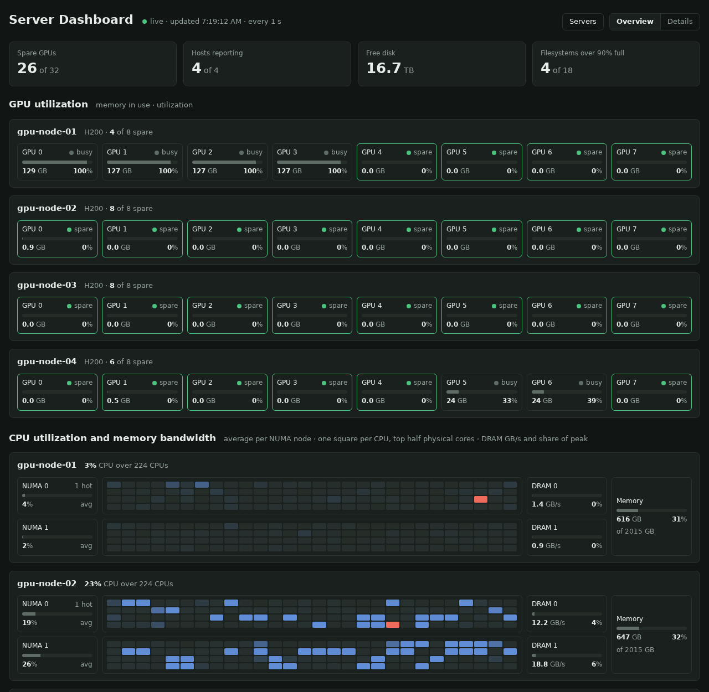

# gpu-pool

Find spare GPUs across the servers in your `~/.ssh/config`, dispatch work to them, and
watch them live. Runs over plain `ssh`; nothing to install on the servers.



**Needs:** Python 3.9+, key-based `ssh` to each server, `nvidia-smi` on the servers.
Optional: DCGM (SM/tensor activity), resctrl (DRAM bandwidth).

## Dashboard

```bash
git clone https://github.com/deng451e/gpu-pool.git && cd gpu-pool
python3 scripts/pool_serve.py        # opens http://127.0.0.1:8765/
```

Click **Servers** to pick hosts from `~/.ssh/config` or any config path; the choice is
saved. macOS app: `python3 mac/build_installer.py --out install.sh && bash install.sh`.

## Find spare GPUs

```bash
python3 scripts/gpu_pool.py                               # every GPU: spare / busy / claimed
python3 scripts/gpu_pool.py --gpu h200 --count 2 --claim  # prints HOST and CUDA_VISIBLE_DEVICES
```

Pool hosts are SSH aliases matching `gpu-*` (set `GPU_POOL_PATTERN` to change).

## Agent skill

```bash
git clone https://github.com/deng451e/gpu-pool.git ~/.claude/skills/gpu-pooling
```

Then ask your agent to "run this on two spare H200s". See [SKILL.md](SKILL.md).

## License

Apache-2.0
