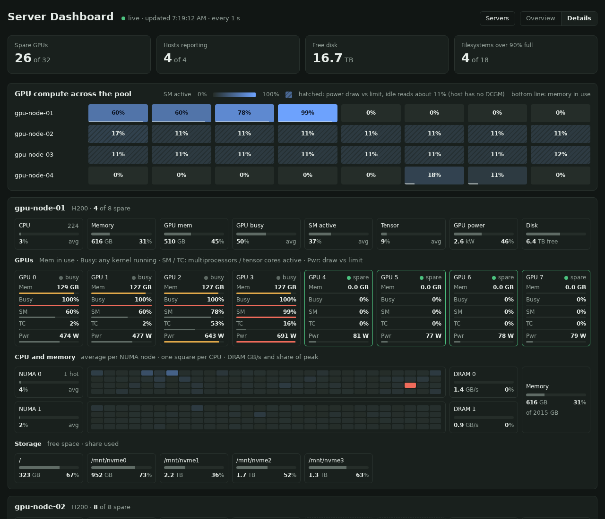

# gpu-pool

Find spare GPUs across the servers in your `~/.ssh/config`, dispatch work to them, and
watch them on a live dashboard. No agents, daemons or databases on the servers: everything
runs over plain `ssh` with `nvidia-smi`, `/proc` and `df`.

- **`gpu_pool.py`**: list every GPU on every server as spare, busy or claimed, then pick
  and claim spare ones of a given model for a job.
- **Dashboard** (`pool_serve.py`): a live web page refreshed every second. It shows GPU
  memory and utilization, SM and tensor-core activity (with DCGM), power, per-core CPU
  load, host memory, DRAM bandwidth (with resctrl) and storage.
- **Agent skill** (`SKILL.md`): a [Claude Code](https://claude.com/claude-code) skill that
  teaches an agent to pick, claim and dispatch a test to spare GPUs, then verify and clean up.
- **`pool_report.py`**: a one-shot JSON snapshot of GPUs, storage and RDMA links
  (`ibv_rc_pingpong` between hosts).
- **`pool_watch.py`**: the same live data in the terminal.


<details>
<summary>Details tab</summary>



</details>

## Requirements

- Python 3.9 or newer (the macOS system `python3` works). No third-party packages.
- Key-based `ssh` to each server that works without a prompt (`ssh -o BatchMode=yes <alias> true`).
- On the servers: `bash` and `nvidia-smi`. Optional: `dcgmi` with a running DCGM host engine
  (SM and tensor-core activity), resctrl mounted (DRAM bandwidth), `ibv_rc_pingpong` (RDMA check).

## Quick start

```bash
git clone https://github.com/deng451e/gpu-pool.git
cd gpu-pool
python3 scripts/pool_serve.py            # opens http://127.0.0.1:8765/
```

Click **Servers** to choose which hosts from `~/.ssh/config` (or another config file) to
track. The choice is saved in `~/.gpu-pool/selection.json` and reused next time.

Before you pick any, the dashboard tracks the aliases matching `gpu-*`. Change that with
`GPU_POOL_PATTERN`, or pass hosts directly:

```bash
python3 scripts/pool_serve.py --hosts 'lab-*,gpu-node-02'
python3 scripts/pool_serve.py --ssh-config ~/work/ssh_config
```

Name your servers in `~/.ssh/config` however you like:

```sshconfig
Host gpu-node-01
    HostName <address>
Host gpu-node-02
    HostName <address>
    Port <port>
Host gpu-*
    User <user>
    IdentityFile ~/.ssh/<key>
```

## Find and claim spare GPUs

```bash
python3 scripts/gpu_pool.py                              # table of every GPU
python3 scripts/gpu_pool.py --gpu h200 --count 2 --claim # pick and claim two H200s
```

```text
HOST=gpu-node-02
HOSTNAME=gpu-node-02
GPU_MODEL=NVIDIA H200
CUDA_VISIBLE_DEVICES=3,4
```

A GPU is spare when it uses at most 1024 MiB, is at most 10% utilized, and is not claimed.
A claim is a file in `/tmp/gpu-pool-claims/` on the host that hides the GPU from other
`gpu_pool.py` runs for 10 minutes, long enough for your job to allocate memory. Exit code 1
means nothing matched.

## Use it as an agent skill

Clone it into your Claude Code skills folder:

```bash
git clone https://github.com/deng451e/gpu-pool.git ~/.claude/skills/gpu-pooling
```

Then ask your agent something like "run this benchmark on two spare H200s". The skill
derives the requirement, claims GPUs, ships the code with `git archive | ssh tar`, starts
the job in `tmux` on the chosen host, verifies nobody else is on those GPUs, and cleans
up. See [SKILL.md](SKILL.md).

## macOS app

```bash
python3 mac/build_installer.py --out install.sh
bash install.sh
```

This installs the dashboard into `~/.gpu-pool`, a `dashboard` command in `~/.local/bin`
(`dashboard stop` ends a background server), and a **GPU Dashboard** app on the Desktop.
The app starts the server in the background and opens the page. `install.sh` is
self-contained, so you can copy it to other Macs.

## Configuration

| Setting | Default | Purpose |
| --- | --- | --- |
| `GPU_POOL_PATTERN` / `--pattern` | `gpu-*` | Comma-separated globs of pool aliases |
| `GPU_POOL_EXCLUDE` / `--exclude` | CI hosts | Regex of aliases to skip (`gpu-ci-01`, `lab-ci2`) |
| `--ssh-config` | `~/.ssh/config` | SSH config to read hosts from |
| `~/.gpu-pool/selection.json` | none | Dashboard's saved Servers choice |
| `~/.gpu-pool/hide` | none | Aliases or globs left out of the default selection |
| `--port`, `--interval` | `8765`, `1` s | Dashboard port and refresh period |

## Security

The dashboard has no authentication and binds to `127.0.0.1`. To view it from another
machine, use an SSH tunnel: `ssh -L 8765:localhost:8765 <host>`. The host-selection API
answers only requests sent to localhost by the page itself (it checks the Host and Origin
headers and accepts JSON POSTs only). Read access to a server is all it needs: it runs
`nvidia-smi`, reads `/proc` and `/sys`, and runs `df` and, if present, `dcgmi dmon`.

## License

Apache-2.0
